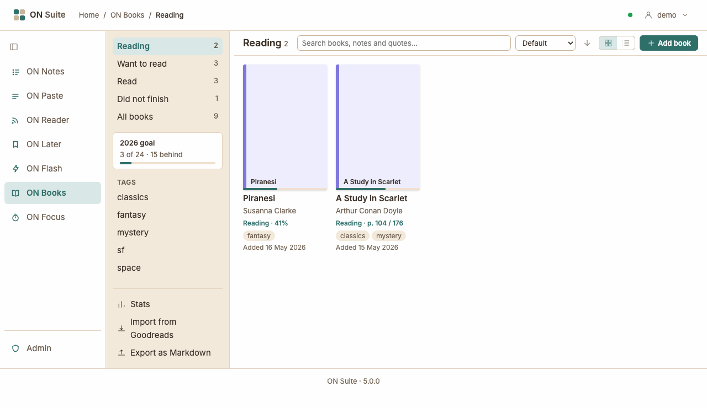
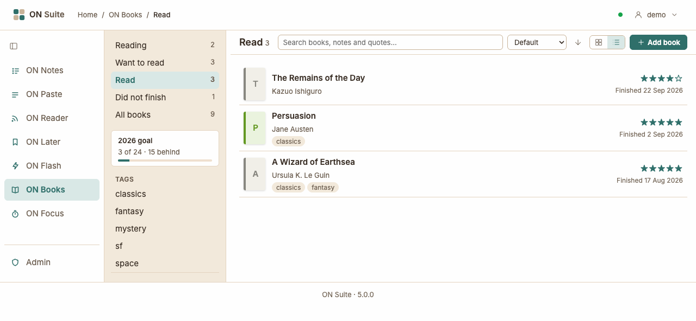
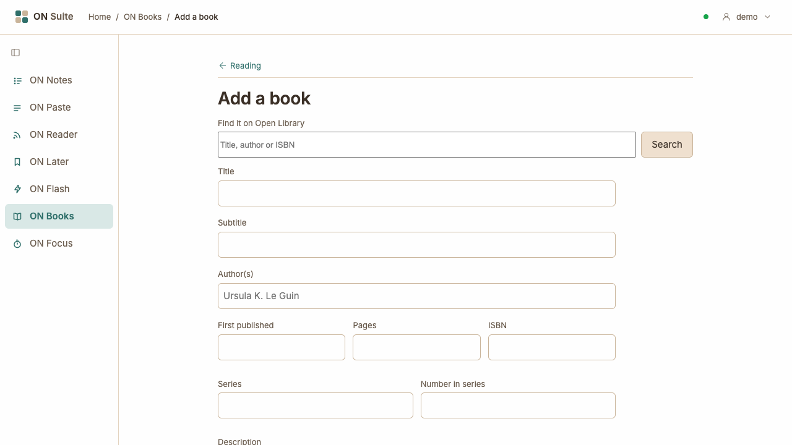
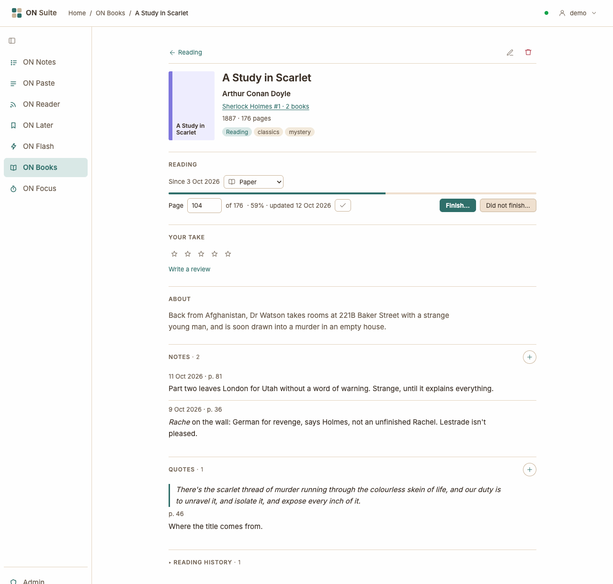
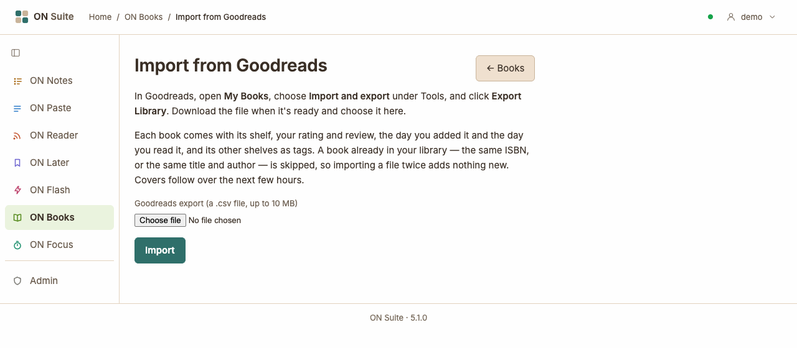
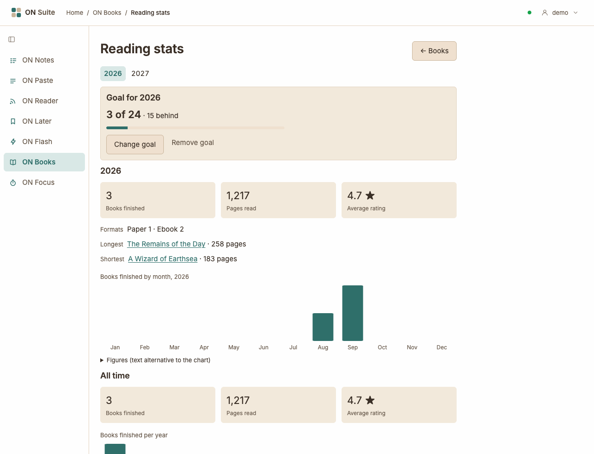

# ON Books

ON Books is a private reading log: what you're reading, what you've read,
what you want to read next and what you gave up on. No friends, no feed —
just your own books.

## Shelves

Every book sits on one shelf:

- **Reading** — books you've started. ON Books opens here.
- **Want to read** — books you haven't started yet.
- **Read** — books you finished.
- **Did not finish** — books you put down.

**All books** shows every shelf at once. The number next to each shelf is
how many books are on it.

You never move a book between shelves yourself: its shelf follows what you
do with it. Start reading it and it moves to Reading; finish it and it moves
to Read.

## Your library

The sidebar lists your shelves. Under them is this year's reading goal, if
you've set one, and then your tags. At the bottom are **Stats**, **Import
from Goodreads** and **Export as Markdown**.

The books on the shelf you picked fill the rest of the page. Each one shows
its cover, title and author, and how it's going: "Reading · 45%" for a book
on the go, your stars for one you've read. Then a few of its tags, and the
day you added it (on the Read shelf, the day you finished it). Click a book
to open it.

Above the books is a toolbar with the search box, the sort, the view and
**+ Add book**:

- **Grid or list.** The two buttons by **+ Add book** show the books as a
  grid of covers or as a list. ON Books remembers your choice.
- **Sort.** Choose **Default**, **Date added**, **Title** or **Author**.
  The arrow next to it reverses the order. Default is each shelf's own
  order: Reading puts the book you read most recently first, Read the one
  you finished most recently, Want to read the one you added most recently,
  and the others the one you changed most recently. **Title** ignores a
  leading "The", "A" or "An", and **Author** goes by the first author's
  surname. ON Books remembers your sort too. A series is always listed in
  reading order.

## Adding a book

Click **+ Add book** in the toolbar. The arrow at the top of the page, and
**Cancel**, take you back to the list you came from.

The quickest way is to find the book on [Open Library](https://openlibrary.org),
a free catalogue of books: type its title, its author or its ISBN into
**Find it on Open Library** and click **Search**. Pick the right one from
the results with **Use this**. The form below fills in with what Open
Library knows — title, author, the year it first came out, the number of
pages, the ISBN and a short description — and the book's cover comes with
it when you add it. Change anything you like before you do.

If the book isn't there, or Open Library doesn't answer, fill the form in
yourself. Only the title is required. An ISBN can be the 10- or 13-digit
kind, with or without hyphens; ON Books keeps it as 13 digits.

Then choose where the book goes:

- **Want to read** — it waits on that shelf.
- **Reading now** — you started it today.
- **Already read** — pick the day you finished it.

You can add tags at the same time, separated by commas.

## A book

A book has a page of its own. The arrow at the top left takes you back to
the list you opened it from. At the top right, ✎ edits the book's details
and 🗑 deletes it.

Under the title are the book's shelf and its tags. Click a tag to see every
book with it. Then come the book's sections: **Reading**, **Your take**,
**About** (its description), **Notes**, **Quotes** and **Reading history**.
A long description is cut short after a few lines; **More** shows the rest.

The rule is simple. The facts about a book — its title, author, series,
cover, tags and description — are changed with ✎, on the Edit page.
Everything about your reading of it is changed right on its page.

## Reading a book

The **Reading** section starts and finishes your readings:

- **Start reading** starts it today and moves it to Reading.
- **Finish…** asks for the day you finished — today, unless you change
  it — and, if you like, a rating; then it moves the book to Read.
- **Did not finish…** asks for the day you stopped and, if you like, the
  page you got to, and moves the book to Did not finish.

A finished book offers **Read again**, and a book you put down offers
**Start again**: either starts a new reading, and the earlier one is kept.
You read a book one time at a time: while you're reading it there's no start
button; finish it or put it down first.

### Progress

While you're reading a book, type the page you're on into the **Page** box
and press Enter, or click ✓. The thin bar above it, and the book's cover on
the Reading shelf, show how far through you are.

For an audiobook — or a book with no page count — the box asks for a
percentage instead. Reaching the last page doesn't finish the book: click
**Finish…** when you're done.

ON Books keeps every update you make. You only see the latest, but they're
what [your stats](#reading-goal-and-stats) count pages from.

### Format

The menu next to "Since…" says how you're reading the book: on paper, as an
ebook, or as an audiobook. Pick another to change it. A new reading starts
with the format of the one before.

## Rating and review

Click a star in **Your take** to rate a book from one to five; click the
same star again to clear it. You can also rate a book as you finish it. The
Read shelf shows each book's stars and the day you finished it.

**Write a review** opens a box for what you thought. You can use a little
Markdown: `**bold**`, `*italic*`, `[a link](https://example.com)`, and a
blank line to start a new paragraph. **Save review** keeps it. Once there's
a review, ✎ at the right of Your take changes it. A book has one rating and
one review, however many times you read it.

## Notes and quotes

**+** at the right of **Notes** opens a box for a note. Give it a page if
you like, and it shows as "p. 112". Notes take the same little Markdown as
reviews, and the newest comes first, with the day you wrote it.

**Quotes** are passages you want to keep. **+** at the right of Quotes opens
a box for the words, an optional comment and an optional page. A quote
keeps its line breaks exactly as you typed them, so poetry stays poetry;
the comment takes Markdown.

Point at a note or quote to see ✎ and 🗑 at its top right. On a phone or
tablet they're always there. ✎ changes it in place; 🗑 removes it, after
asking. A page has to be one the book has — from 1 to its page count.

## Reading history

At the bottom of a book is **Reading history**, folded away; click it to
see every time you've read the book, newest first: when you started and
finished, the format, and how it ended. ✎ changes a reading's dates and
format. To fix a reading that ended the wrong way — marked as read when you
gave up, say — delete it with 🗑; the book's shelf follows whichever reading
is left.

## Covers

A book added from Open Library brings its cover. A book without one shows
a coloured spine with its title instead.

To change a cover, open the book, click ✎, and under **Cover** either
upload an image or paste the address of one on the web. JPEG, PNG, GIF and
WebP images up to 2 MB work. **Remove the cover** goes back to the spine.
ON Books keeps its own copy of every cover, so they show even if the
original disappears.

A book without a cover offers **Find a cover on Open Library** under
**Cover** on the Edit page. It asks Open Library for one straight away: by
the ISBN, or by the title and author when there's no ISBN or Open Library
has no cover for it. It uses what's in the form, even if you haven't saved
it yet. The cover is saved as soon as it's found; anything else you've
changed stays in the form, waiting for **Save**. If there's no cover to be
had, ON Books says so, and you can add one yourself.

Books with an ISBN but no cover — books you imported, say — get theirs in
the background, a few every few minutes, so a big import fills in over a
few hours. A cover you remove stays removed.

## Series

If a book is part of a series, its series and number show under the
author — "Sherlock Holmes #1 · 2 books". Click it to list the series in
order. Add a series name and number with ✎ on the book's page.

## Tags

Tags are your own labels — *sf*, *book club*, *favourites*. Add them as you
add a book, or change them with ✎ on the book's page: the **Tags** box
takes them separated by commas. Your tags are listed in the sidebar; click
one, or a tag on a book's page, to see every book with it. A tag nobody
uses any more disappears.

## Finding a book

Type in the search box above your books to search them: their titles,
subtitles, authors and series, and everything you've written about them —
reviews, notes, quotes and quote comments. Every word you type has to
match, and the list narrows while you're still typing a word.

While you're searching, the books show as a list, whichever view you
picked, so there's room to show where each one matched. When a book
matched inside a review, note or quote, its row gets a line showing where,
with the matching words highlighted — "Quote: The spice must flow."
Clear the box to get your view back.

The search stays within the shelf, tag or series you're looking at, and
stays as you switch shelves.

## Editing and deleting

On a book's page, ✎ at the top right changes its details: the title,
author and the rest, its cover and its tags. 🗑 removes the book for good,
with its readings, notes and quotes, after asking.

## Importing from Goodreads

**Import from Goodreads**, at the bottom of the sidebar, brings your
Goodreads library over in one go. In Goodreads, open **My Books**, choose
**Import and export** under Tools, and click **Export Library**. Download
the file when it's ready, choose it on the import page and click
**Import**. Files up to 10 MB work — a few thousand books.

Each book comes over with:

- its shelf: *read* books are finished on the day you read them,
  *currently-reading* books are being read since the day you added them,
  and *to-read* books wait on Want to read. A book you read more than once
  gets an earlier reading, without dates, for each time before.
- your rating (a book you didn't rate has none), your review, and your
  private notes, as a note dated the day you added the book;
- the day you added it, the number of pages, the year it first came out
  and its ISBN;
- its series, when Goodreads puts one in the title — "Leviathan Wakes
  (The Expanse, #1)" becomes Leviathan Wakes, The Expanse #1;
- its format, when the binding says — a Kindle edition is an ebook, an
  Audible one an audiobook, a paperback or hardcover paper;
- your other Goodreads shelves, as tags. A shelf of your own that takes
  the place of read or to-read, like *owned*, becomes a tag too, and the
  book goes on Want to read.
- a book on a shelf called *dnf*, *did-not-finish* or *abandoned* goes on
  Did not finish instead, stopped on the day Goodreads says you read it,
  if it says.

A book that's already in your library is skipped: the same ISBN, or —
when one of the two has no ISBN — the same title and author. So importing
the same file twice adds nothing new. When it's done, the page says how
many books came in, and which ones were skipped.

If something in the file can't be read, nothing is imported, and the page
says which line of the file is wrong.

## Exporting your books

**Export as Markdown**, at the bottom of the sidebar, downloads your whole
library as one file, `books-export.md`: every book with its details and
description, your readings, rating and review, notes and quotes, in
alphabetical order.
Markdown is plain text, so it opens in any text editor and outlives any
app.

ON Books is also part of the [complete export](admin.md#exporting-someones-data)
an admin can make of everything you keep in ON Suite. Covers aren't in
either.

## Reading goal and stats

**Stats**, at the bottom of the sidebar, opens a page of numbers about your
reading. It shows this year to begin with; the years along the top switch
to another one.

For the year you get:

- **Books finished** — every time you finished a book that year. A book you
  read twice counts twice; books you didn't finish don't count.
- **Pages read** — worked out from your progress updates, on the days you
  made them. Going from page 120 to page 180 is 60 pages. Only pages past
  the furthest point you've reached in this reading count, so fixing a
  mistake doesn't count anything twice: if you typed 250 instead of 150,
  then put it right and went on to 180, the stats count 250 pages, not
  280, and nothing more until you pass page 250. When you finish a book,
  the rest of it, from the furthest point you reached, counts on the day
  you finished, so a book you finished without ever updating its progress
  counts in full. Reading a book again starts from page 1. Progress kept
  in percent — an audiobook's, say — turns into pages through the book's
  page count, so percent progress on a book with no page count adds no
  pages. Page numbers still count, but finishing a book with no page count
  adds nothing. A book you added as read without a date adds no pages
  either, even to All time.
- **Average rating** of the books you finished that year.
- How many you read on paper, as ebooks and as audiobooks, and the
  longest and shortest book you finished.
- A chart of the books you finished each month.

Under **All time** are the same three numbers for everything you've read,
and a chart of the books you finished each year. A book you added as read
without a date — imported, say — counts toward All time but not toward any
year.

### A yearly goal

Set a goal on the Stats page: type how many books you'd like to read that
year and click **Set goal**. The page then shows how you're doing — "12 of
30" — and whether you're ahead or behind: by the middle of the year you'd
expect to have read half your goal. **Change goal** and **Remove goal** do
what they say. You can set a goal for next year ahead of time, too.

While this year has a goal, a small card in the sidebar shows how you're
doing. Click it to go to your stats.

## Keyboard shortcuts

In your library:

- **j** / **k** — move to the next / previous book
- **Enter** or **o** — open it
- **/** — jump to the search box
- **a** — add a book

On a book's page:

- **p** — jump to the progress box
- **n** — add a note
- **q** — add a quote
- **e** — edit the book's details
- **Esc** — close an open box (Finish…, Did not finish…, the review, or a
  note, quote or reading you're changing); with none open, go back to your
  library. An open Reading history isn't a box: Esc goes back and leaves it
  as it is

## On a phone

On a narrow screen the sidebar folds away. The button at the top left,
named after the shelf you're on, slides it in; pick a shelf or tag, tap
beside it or press Esc to close it again. A book's page is the same single
column as on a computer, with the cover above the title.
